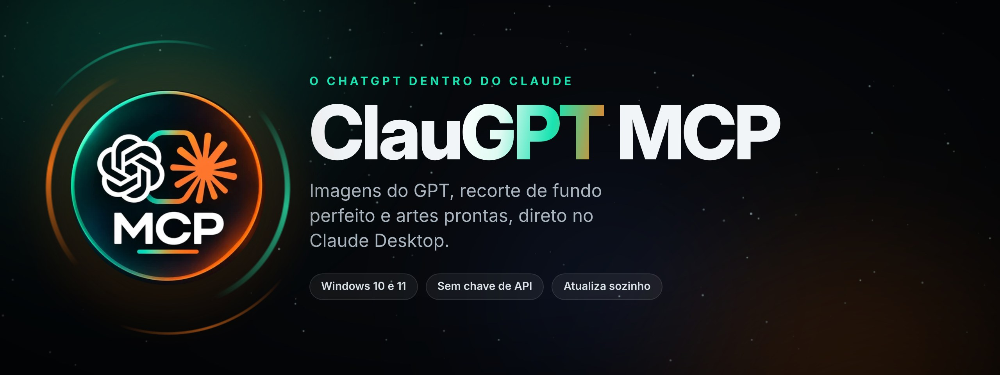
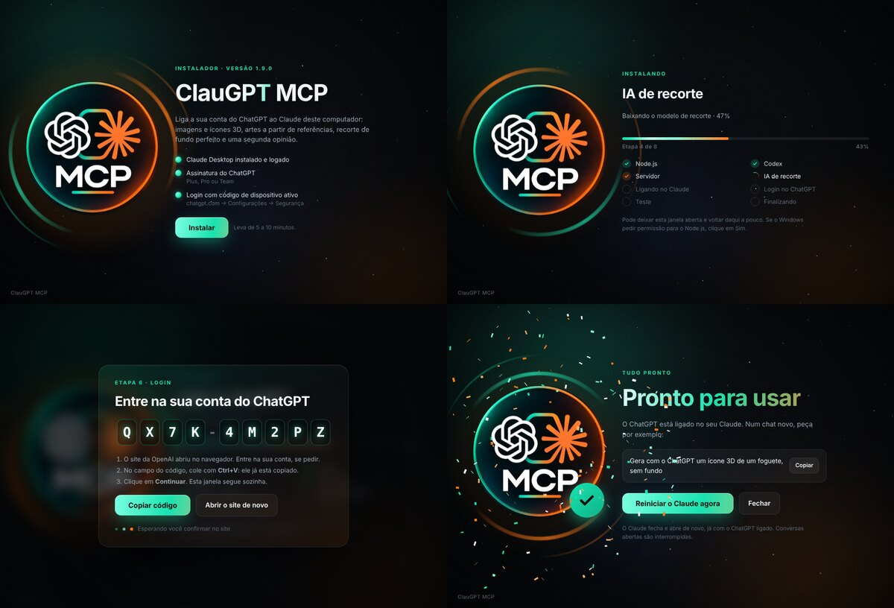
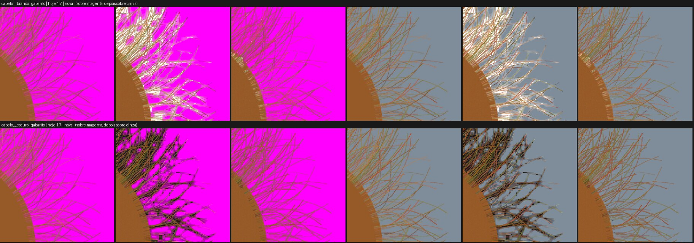
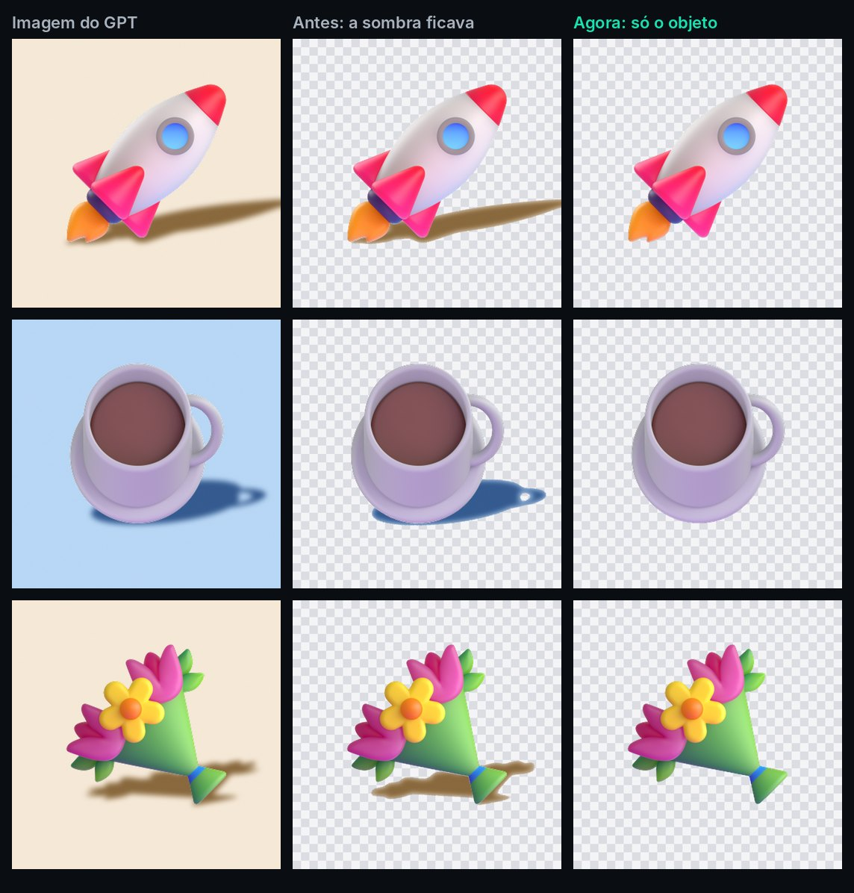
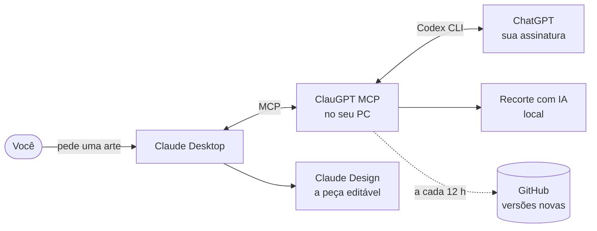

<p align="center">
  
</p>

<p align="center">
  <a href="https://github.com/NUCLEO7LABS/mcp-chatgpt-n7/releases/latest/download/Instalar-ClauGPT-MCP.exe"></a>
  <a href="https://github.com/NUCLEO7LABS/mcp-chatgpt-n7/releases/latest"></a>
  
  <a href="#no-linux"></a>
</p>

<p align="center"><b>Sua conta do ChatGPT, dentro do Claude Desktop e do Claude Code.</b><br>
Imagens e ícones 3D do GPT, recorte de fundo de verdade, artes montadas com a marca certa e uma segunda opinião do ChatGPT, sem chave de API e sem sair do Claude.</p>

---

## O que ele faz

| | |
|---|---|
| **Gera com o GPT** | Fotos, cenas, produtos, mascotes, ícones e objetos 3D, ilustrações. Também recria uma arte a partir de uma referência ou edita uma imagem. |
| **Amplia com IA** | O GPT da assinatura entrega ~1 megapixel; cada imagem sai ampliada 2× no próprio computador, nítida no story e na exportação em 2×. |
| **Recorta o fundo** | No próprio computador, em uns 3 segundos, com ~1 GB de memória. Cabelo e pelo fio a fio, vidro, sombra no chão (tira ou mantém), sem halo. |
| **Monta a peça** | Post, story e anúncio no Claude Design: a imagem do GPT, o logo real e os textos de verdade, numa tela editável, uma prancheta por formato. |
| **Lembra da marca** | Kit por marca com logo, cores, fontes, tom de voz e artes de referência, que o Claude usa sozinho. |
| **Pergunta ao ChatGPT** | Uma segunda opinião sobre texto, código ou imagem, com conversa contínua. |
| **Se cuida sozinho** | Atualiza sozinho quando sai versão nova, e tem diagnóstico para quando algo não anda. |

Tudo pela sua assinatura do ChatGPT (Plus, Pro ou Team), pelo [Codex CLI](https://github.com/openai/codex) oficial da OpenAI.

## Instale em 5 minutos

1. **[Baixe o instalador](https://github.com/NUCLEO7LABS/mcp-chatgpt-n7/releases/latest/download/Instalar-ClauGPT-MCP.exe)** e abra. Se o Windows avisar, clique em *Mais informações → Executar assim mesmo*.
2. Clique em **Instalar**. A janela mostra cada etapa.
3. No login, o site da OpenAI abre sozinho e o código já fica copiado: cole com **Ctrl+V** e clique em Continuar.
4. Clique em **Reiniciar o Claude agora**. Pronto.

<p align="center"></p>

> **Antes de instalar:** Claude Desktop instalado e logado, e o *login com código de dispositivo* ativado em chatgpt.com → Configurações → Segurança (uma vez por conta).

Depois, num chat novo do Claude, é só pedir:

```text
Gera com o ChatGPT um ícone 3D de um foguete, sem fundo
Faz um post e um story da Ninno para o Dia dos Pais, com a foto de um hambúrguer
Tira o fundo de Downloads\produto.jpg e mantém a sombra no chão
```

## No Linux

Um comando no terminal, sem senha de administrador (tudo fica na sua pasta de usuário):

```bash
curl -fsSL https://github.com/NUCLEO7LABS/mcp-chatgpt-n7/releases/latest/download/instalar-linux.sh | bash
```

Ele instala o Node.js (se o do sistema for antigo), o Codex CLI, o servidor e o modelo de recorte, liga no **Claude Code** e, se houver, no Claude Desktop (as versões não oficiais para Linux, que usam `~/.config/Claude`), faz o login no ChatGPT por código e testa com uma pergunta de verdade. Pode rodar de novo quando quiser: atualiza o que mudou e pula o resto.

- **Precisa de:** `curl` e `tar` (vêm em quase todo Linux), Ubuntu 20.04, Debian 11, Fedora 36 ou mais novo (x64 ou ARM). Para montar artes, o Google Chrome ou o Chromium.
- **Fica em:** `~/.local/share/clauGPT-mcp`; as imagens vão para a sua pasta de Imagens (`~/Imagens/ChatGPT`).
- **Desinstalar:** o mesmo comando com `| bash -s -- --remover`.

## Recorte de fundo

Feito para o que o GPT gera, sobre fundo liso, mas serve para qualquer imagem. O modelo de IA (IS-Net, leve) separa o objeto do fundo de forma grosseira. A borda sai da **conta das cores**: com a cor do fundo conhecida em cada ponto, a transparência de cada pixel vem da mistura entre objeto e fundo, e não de um palpite.

<p align="center"></p>
<p align="center"><sub>Cabelo de perto, sobre magenta e sobre cinza: o recorte perfeito (gabarito), a versão antiga e a atual.</sub></p>

<p align="center"></p>
<p align="center"><sub>Sombra colorida no chão: a versão antiga deixava a sombra grudada no objeto; a atual tira (ou mantém, se pedido, no tom certo).</sub></p>

Medido contra o recorte perfeito em centenas de casos de teste (ícones 3D, vidro, bolhas, planta, "cabelo" com fios finos; fundo branco, colorido, escuro, degradê, chão com parede; sombra de contato, projetada, suave e colorida):

| | Antes (1.7) | Agora |
|---|---|---|
| Memória por recorte | ~7,5 GB | **~1,1 GB** |
| Tempo por recorte | ~14 s | **~3 s** |
| Cabelo: pixels errados | 2,3 a 3,8% | **menos de 0,01%** |
| Sombra colorida: pixels errados | 0,8% | **0,02%** |

## Como funciona



- O **Claude** é o diretor de arte: lê o kit da marca, decide o que pede ao GPT e monta a peça.
- O **GPT** gera só o que precisa ser imagem (foto, cena, objeto 3D), sem texto e sem logo.
- O **recorte** roda no seu computador e não gasta o limite do ChatGPT.
- O **Claude Design** recebe a imagem, o logo real e os textos, num formato que você edita clicando.

## Atualização automática

O servidor confere o GitHub pouco depois de abrir e a cada 12 horas, pelo link fixo de download das versões (sem a API do GitHub, que limita a 60 consultas por hora por endereço de internet; numa empresa, todos os PCs saem pelo mesmo).

- **Saiu versão nova que só muda o código:** ele baixa, confere a impressão digital (SHA-256), guarda a versão atual para voltar atrás e instala. O Claude avisa: *reinicie o Claude para usar*.
- **Saiu versão que muda as bibliotecas:** ele não troca nada com o Claude aberto e avisa com o link do instalador novo.
- Peça ao Claude *"vê se tem atualização do ClauGPT"* para conferir na hora (ferramenta `atualizar_mcp`).
- Para desligar: variável `CHATGPT_ATUALIZACAO=0` na configuração do servidor.

## Ferramentas

| Ferramenta | Para quê |
|---|---|
| `gerar_imagem` | O GPT gera ou edita imagens, com ou sem fundo, a partir de texto ou de referências, já ampliadas 2× com IA |
| `ampliar_imagem` | Amplia qualquer imagem 2× a 4× com IA no computador (foto do cliente, logo pequeno) |
| `remover_fundo` | Recorte com IA no computador, com opção de manter a sombra no chão |
| `renderizar_arte` | Monta uma peça em HTML no tamanho exato e salva o PNG (alternativa ao Claude Design) |
| `kit_de_marca` / `salvar_marca` | Logo, cores, fontes, tom e referências de cada marca |
| `entregar_artes` / `ver_imagem` | Mostra as artes e imagens do computador na conversa |
| `perguntar_chatgpt` | Segunda opinião do ChatGPT |
| `aguardar_resultado` | Pega o resultado de um trabalho que passou do tempo do chat |
| `diagnostico` | Confere Codex, login, recorte, navegador, pastas e atualização |
| `atualizar_mcp` | Confere e instala a versão mais nova |

<details>
<summary><b>Perguntas comuns</b></summary>

**Preciso de chave de API da OpenAI?** Não. O Codex CLI entra com a sua conta do ChatGPT; as imagens contam no limite da sua assinatura.

**Meus arquivos vão para algum lugar?** O recorte e a montagem das artes rodam no seu computador. Para o ChatGPT só vai o que você pede para ele gerar ou analisar.

**Funciona no navegador ou no celular?** Não: precisa do Claude Desktop no Windows, ou do Claude Code no Linux.

**Funciona no Mac?** Ainda não tem instalador para Mac.

**Como desinstalo?** No Windows, feche o Claude e vá em *Configurações → Aplicativos → ClauGPT MCP → Desinstalar*. No Linux, rode o comando de instalação com `| bash -s -- --remover`. Imagens e kits de marca ficam.

**Deu erro na instalação.** A janela mostra a etapa; quase sempre basta *Tentar de novo*. O registro fica em `%LOCALAPPDATA%\mcp-chatgpt\instalacao.log` (no Linux, `~/.local/share/clauGPT-mcp/instalacao.log`): mande para o Claude que ele diz o que fazer.

</details>

## Para quem desenvolve

```bash
npm install
npm run build
node empacotar.mjs        # gera o .exe, o .cmd, o instalar-linux.sh e o pacote de atualização em saida/
```

- **Código:** `src/index.ts` (servidor e ferramentas), `src/recorte.ts` (recorte de fundo), `src/arte.ts` (HTML → PNG), `src/marca.ts` (kits de marca), `src/atualizacao.ts` (atualização automática).
- **Instalador:** `instalador/instalador.nsi` (o .exe, NSIS 3), `iniciar.ps1` e `interface/index.html` (a janela), `instalar.ps1` (as etapas), `registrar.cjs` (liga no Claude), `instalar-linux.sh` (o instalador do Linux).
- **Ver a janela do instalador sem instalar:** `node ferramentas/mock-interface.mjs` e abra `http://127.0.0.1:8765/`.
- **Publicar uma versão:** aumente `version` no `package.json` (e no `package-lock.json`) e `VERSAO` em `src/index.ts`, escreva as notas em `docs/notas/vX.Y.Z.md` e envie para a `main`. O GitHub Actions (`.github/workflows/publicar.yml`) vê que a versão ainda não foi publicada, compila, gera o instalador e o pacote de atualização e cria a versão. Os PCs instalados se atualizam sozinhos em até 12 horas.

O guia técnico completo (variáveis, recorte, kits de marca, formatos, como o instalador funciona) está em [docs/TECNICO.md](docs/TECNICO.md).

<p align="center"><sub>Feito pela Branding7 · uso interno · o ClauGPT MCP não é um produto da OpenAI nem da Anthropic.</sub></p>
